# Cambios sobre la versión original

**Estado final:** TypeScript sin errores · **87/87 tests** (10 suites) · toda la app verificada en el emulador (Pixel 8, Expo Go SDK 54) contra la API de la cátedra corriendo en `10.0.2.2:3000`.

Las capturas están en [`docs/capturas/`](./capturas/).

---

## 1. Infraestructura y configuración

| Cambio | Archivos | Por qué |
|---|---|---|
| Migración `fetch` → **axios** (pedido de la cátedra) | `src/servicios/api.ts`, `package.json` | `pedir()` mantiene el mismo contrato (sobre `datos`/`error`, `ErrorApi` con código y mensaje, 204 sin cuerpo) pero viaja por axios con `validateStatus: () => true` para que los 4xx los decida el sobre de la API y no axios. |
| Permisos declarados en la config | `app.json` | Plugins `expo-camera`, `expo-location`, `expo-notifications` con mensajes en lenguaje natural + `android.permissions` (CÁMARA, UBICACIÓN, VIBRATE, POST_NOTIFICATIONS). Sin esto, el build de iOS se rompe y Android lo rechaza del Store. |
| Build de APK habilitado | `eas.json` | Perfil `preview` con `buildType: "apk"` para el entregable. |
| Ícono en PNG plano RGB | `assets/images/directorio-icon.png` | La consigna pide 1024×1024 sin transparencias. |
| Dependencias nuevas | `package.json` | `axios`, `test-renderer` (framework de tests de Expo 54), `react-native-svg@15.12.1` + `react-native-qrcode-svg@6.3.54` (para el QR del vecino). |
| Limpieza | `src/mocks/resenas.ts` eliminado | Mock muerto: las reseñas van contra la API desde la migración anterior. |

**Ambiente:** la Play Store instala siempre el Expo Go más nuevo (SDK 58), que no puede correr proyectos SDK 54 — por eso el emulador nuevo quedó con **Expo Go 54.0.8** instalado por `adb install` desde los releases oficiales de Expo.

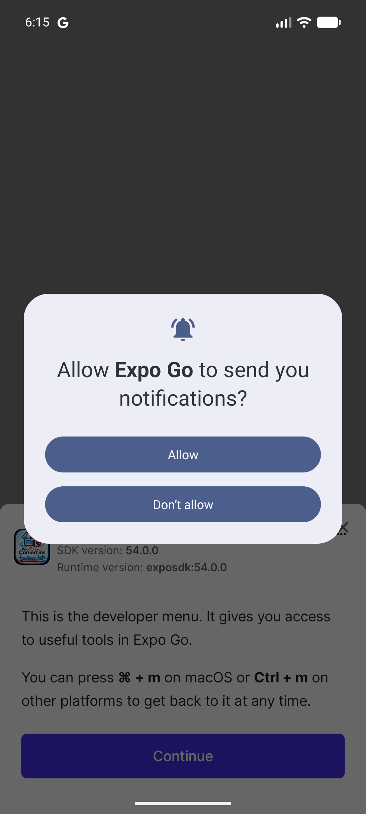

La app corriendo en el emulador nuevo con los 39 comercios de la API real:

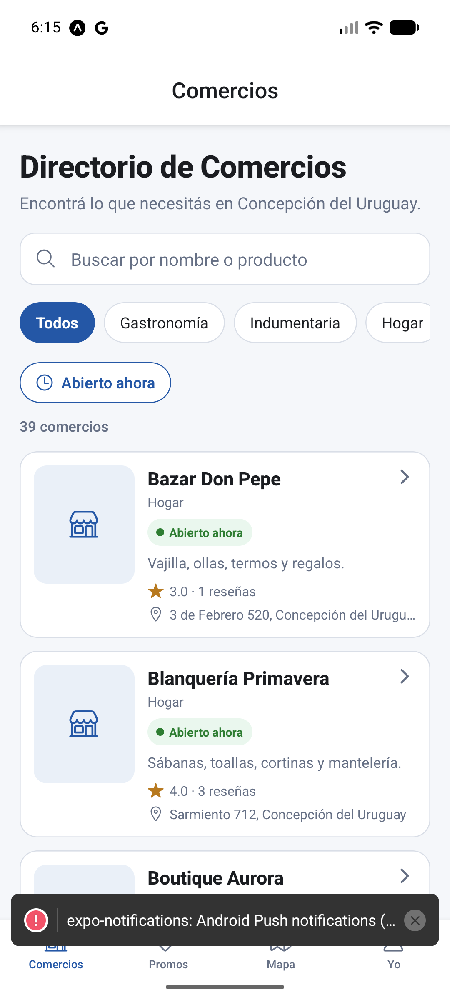

---

## 2. Reseñas interactivas (módulo de Matías)

**Qué había:** la ficha mostraba las reseñas en modo **sólo lectura** (autor, estrellas, comentario y respuesta del comercio). Los tres componentes interactivos (`formulario-resena`, `formulario-respuesta`, `tarjeta-resena`) existían con sus tests, pero **ninguna pantalla los importaba**: no se podía dejar una reseña, responder, reportar ni editar/borrar. La versión interactiva completa existía sólo en la carpeta vieja `Melina-Casco-Test`; hubo que **trasplantarla** a este proyecto adaptándola (tema claro/oscuro con `crearEstilos(colores)`, nombres reales de autor, `ErrorApi` tipado).

**Qué se cambió:**
- `app/comercio/[id].tsx` — sección de reseñas completa: botón "Escribir una reseña" / "Editar mi reseña" / "Iniciá sesión para reseñar" (manda al login), tarjetas con **Editar/Borrar** (con confirmación) en las propias y **Reportar** en las ajenas, **Responder** sólo para el dueño del comercio y sólo en reseñas sin respuesta, **pull-to-refresh**, refresco al volver al foco (`useFocusEffect`), distinción **error vs. sin reseñas** con botón Reintentar, y aviso de "reseñas guardadas" cuando vienen del cache sin conexión.
- `src/components/resenas/tarjeta-resena.tsx` — nueva prop opcional `autor` (muestra el nombre real) y `colores` (tema). Sin tocar su lógica: los tests existentes siguen pasando.
- `src/components/resenas/formulario-resena.tsx` y `formulario-respuesta.tsx` — prop opcional `colores` + **corrección de un bug real** (ver §7).

Ficha con botón de reseña y favorito:

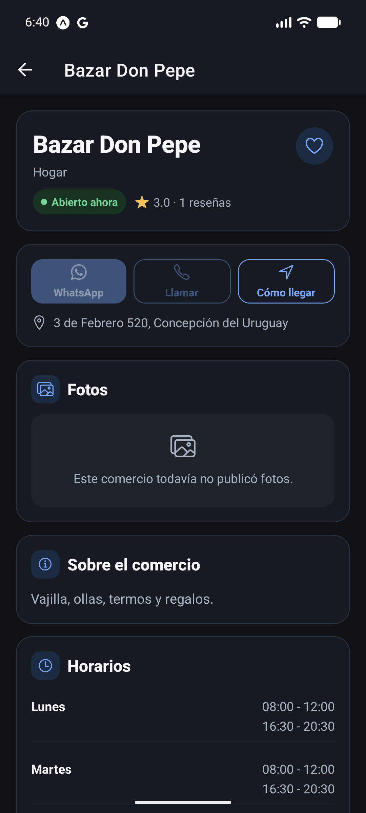

Acciones sobre la reseña propia (Editar / Borrar):

"Reportar" en las reseñas de otros vecinos:

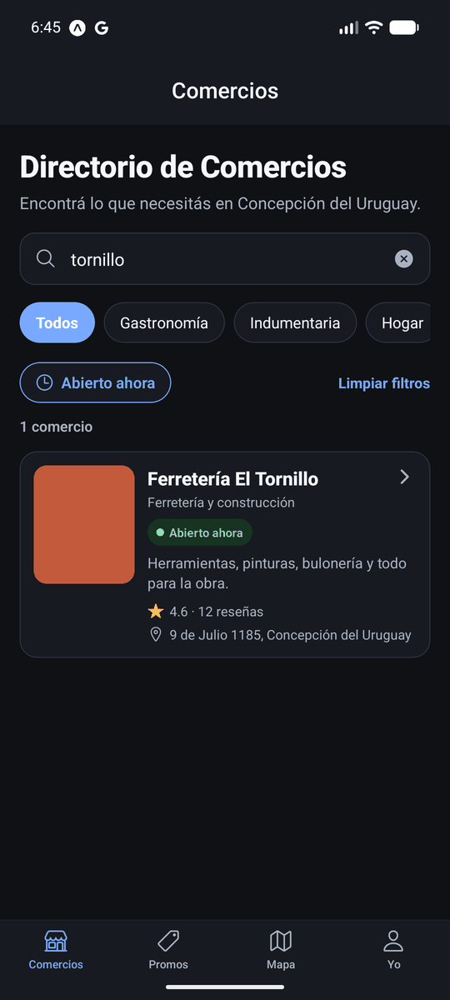

**Responder como dueño** — el botón sólo aparece para la cuenta del comercio y en reseñas sin respuesta:

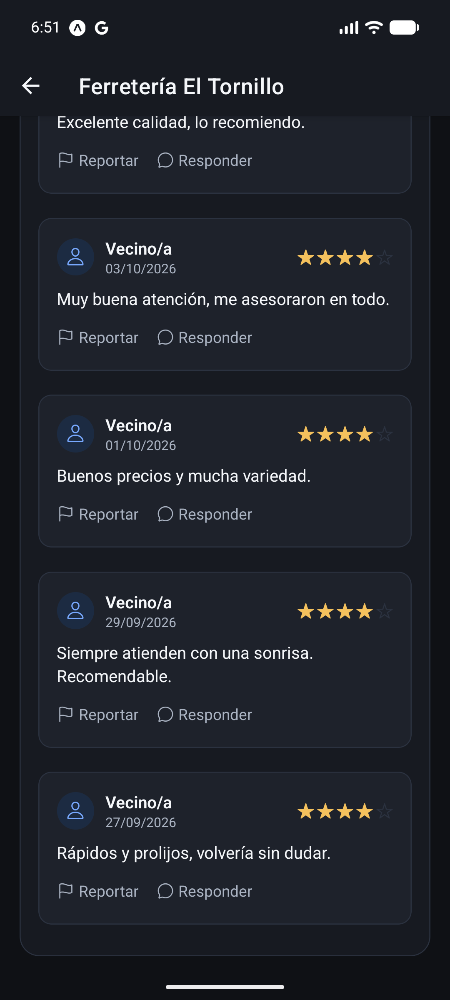

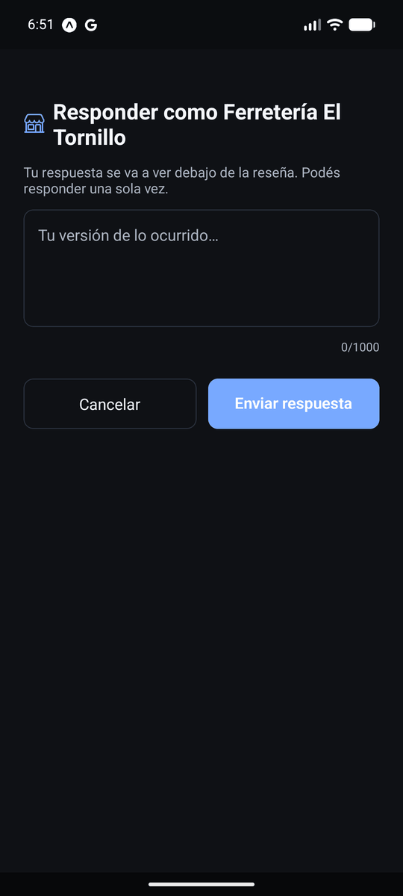

Respuesta publicada y renderizada dentro de la tarjeta (y el botón Responder desaparece — regla de una sola vez):

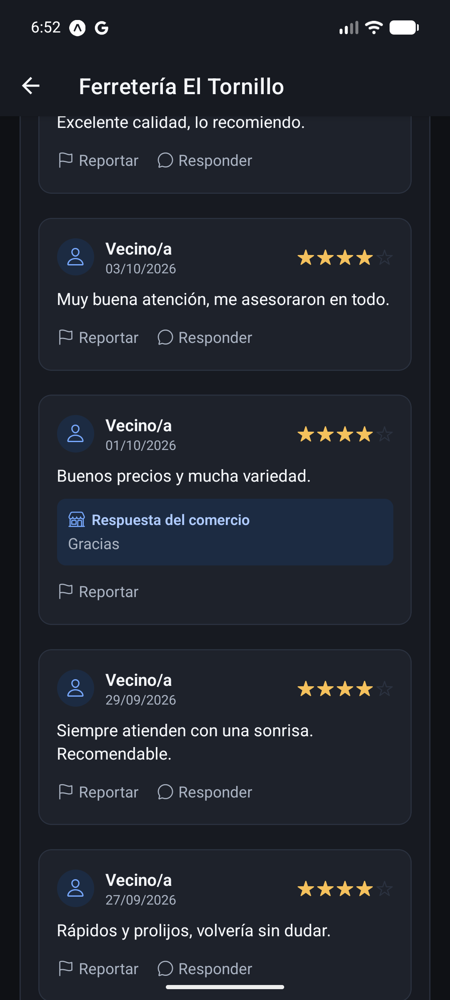

Edición guardada contra la API: la reseña pasó de 3★ a 4★ y el promedio del listado se actualizó a "4.0 · 1 reseña":

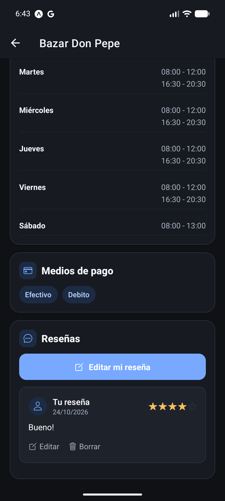

Reseña escrita **sin conexión** (durante otra sesión) y sincronizada después — "Tu reseña" en Farmacia del Pueblo con sus acciones:

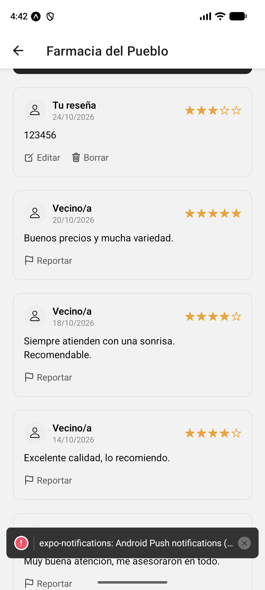

---

## 3. "Mostrar mi código" — lado vecino del QR

**Qué había:** el escáner del comercio (biometría → cámara → confirmación con háptica → `registrarUsoPromocion`) estaba completo, pero el detalle de promoción era un listado de campos sin ninguna acción: el vecino no podía generar el código y en una demo no había nada que escanear.

**Qué se cambió:**
- `app/promocion/[id].tsx` reescrito completo: tema, tarjeta del comercio clicable, y el bloque **"Tu código exclusivo"** — botón Mostrar/Ocultar que revela el **QR en pantalla** (sobre panel blanco a propósito: los escáneres fallan con QR invertidos en tema oscuro) + el código en texto como plan B + instrucciones para el mostrador. Estados: sin sesión → botón a login; ya usada → "Promoción ya utilizada" con fecha.
- `src/utils/qr.ts` — nuevo `construirCodigoPromocion()`: el payload que muestra el vecino (`PROMO|pro-441|usr-512`) es **exactamente** el que `interpretarQrPromocion()` del escáner parsea. Hay un test de ida y vuelta que lo garantiza.

Detalle nuevo con el bloque "Tu código exclusivo":

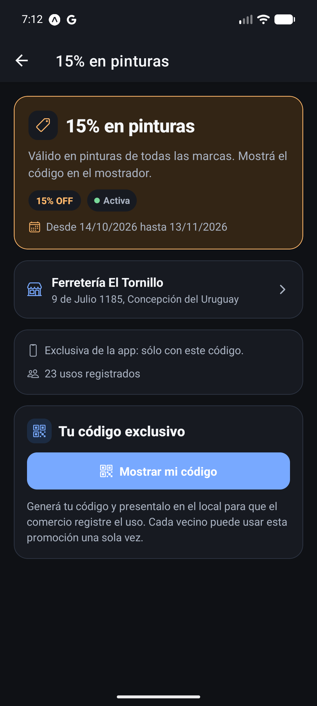

QR renderizado:

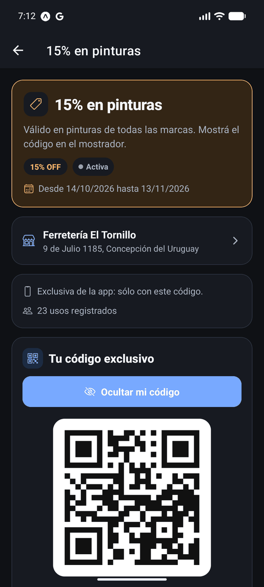

Código en texto (mismo payload que valida el escáner):

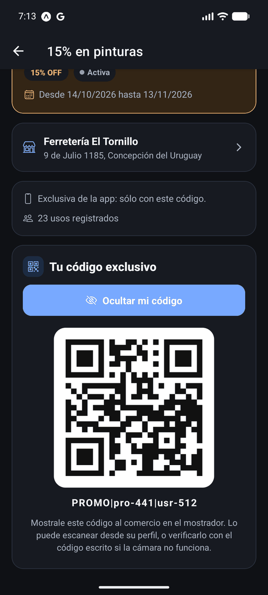

---

## 4. Pestaña Promos: categorías y filtro por rubro

**Qué había:** lista plana de vigentes.

**Qué se cambió:**
- `src/servicios/promociones.ts` — nuevo `obtenerPromocionesPorEstado()`. La API distingue exactamente los tres estados del PRD (`?estado=vigentes|proximas|por-vencer`); las vigentes conservan el cache offline, las otras dos necesitan red y la pantalla muestra error con Reintentar.
- `app/(tabs)/promociones.tsx` reescrito: chips de **categoría** (Vigentes / Próximas / Por vencer), chips de **rubro** (cruza comercios↔rubros), nombre del comercio en cada tarjeta, texto de vigencia según categoría ("Arranca el…" / "Termina el…" / "Vigente hasta…"), pull-to-refresh y vacíos con mensaje.

Categorías + filtro de rubro + comercio en la tarjeta:

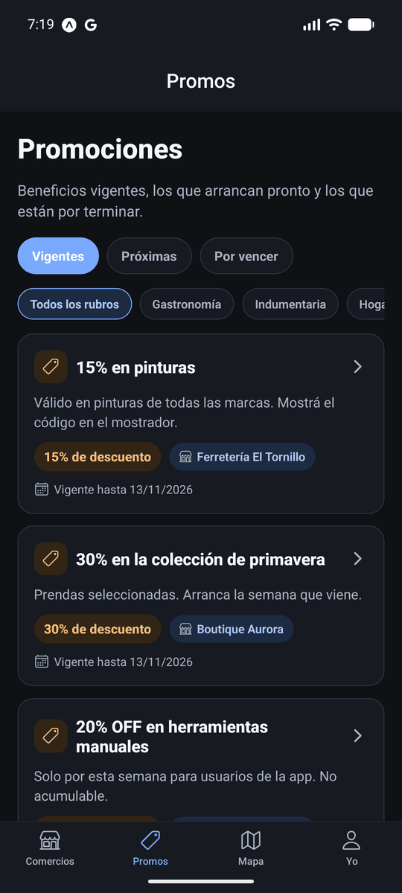

"Por vencer" con datos reales (promo que vence al día siguiente):

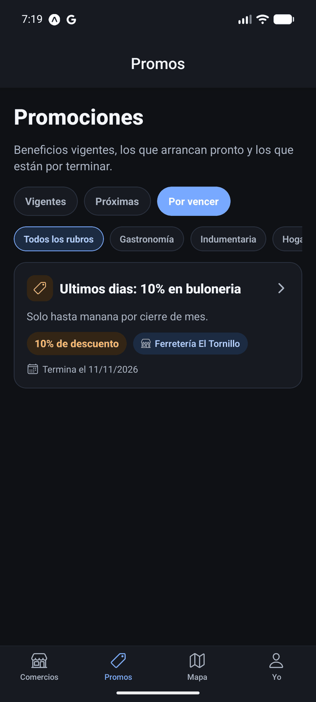

Filtro por rubro (Indumentaria → sólo Boutique Aurora):

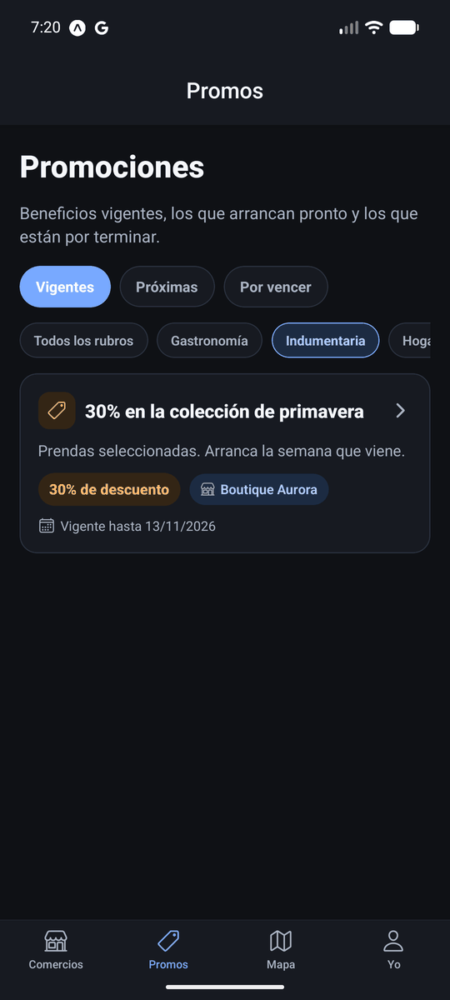

---

## 5. mi-comercio: gestión de promociones + usos

**Qué había:** `mi-comercio` sólo editaba datos generales. El CRUD de promos vive en la API (`GET/POST/PATCH/DELETE /mi-comercio/promociones`) pero no tenía UI.

**Qué se cambió:**
- Nueva pantalla `app/mis-promociones.tsx` (acceso en Herramientas del comercio): lista con **TODAS** las promos propias — activas, vencidas y dadas de baja — con chip de estado (`estadoDePromocion`), **contador de usos**, marca "Sólo app", vigencia, y acciones Editar / Dar de baja (baja lógica con confirmación).
- Nuevo componente `src/components/promociones/formulario-promocion.tsx`: alta y edición con prefill, interruptor "Sólo con la app" y errores visibles.
- `src/utils/promociones.ts` — helpers puros con tests: `validarBorradorPromocion` (título 1-120, detalle, descuento entero 1-100 o vacío, fechas coherentes), `armarCuerpoPromocion` (AAAA-MM-DD → ISO con zona), `estadoDePromocion`, `parteFechaIso`. **+15 tests.**
- `src/servicios/mi-comercio.ts` — CRUD completo con el patrón de `pedir`.

Panel con estados y usos:

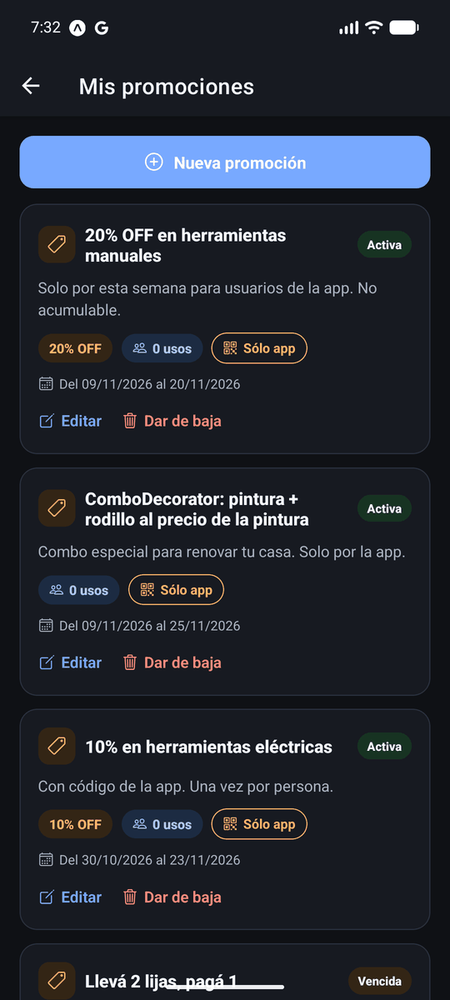

Formulario de alta:

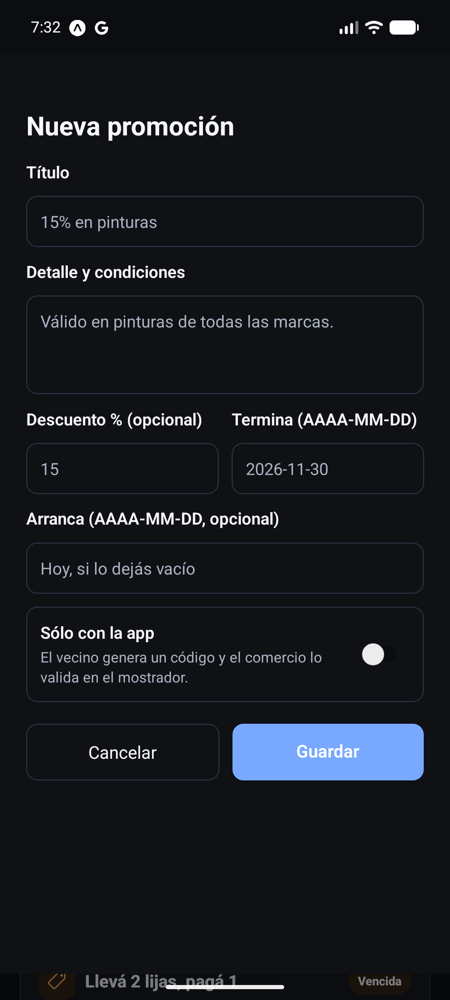

Validación en vivo (guardar vacío):

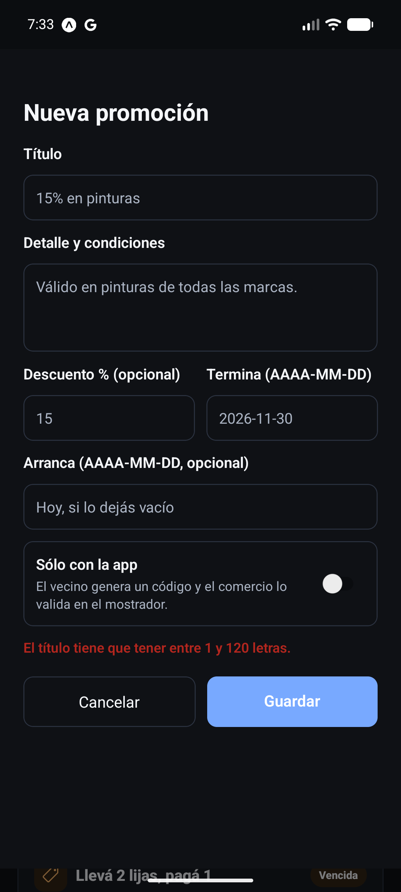

Promo creada — aparece primera con Activa y 0 usos:

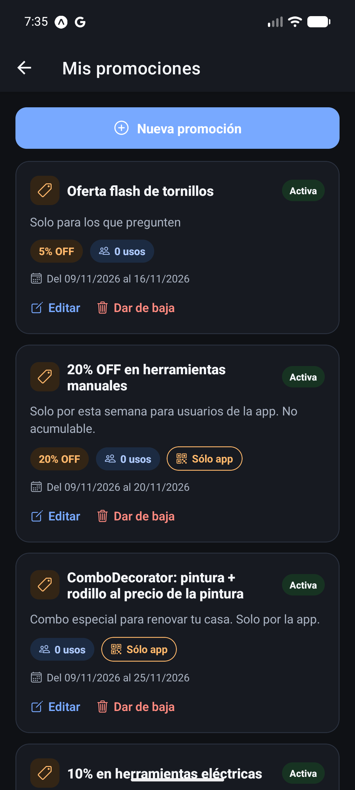

Edición guardada (5% → 7%):

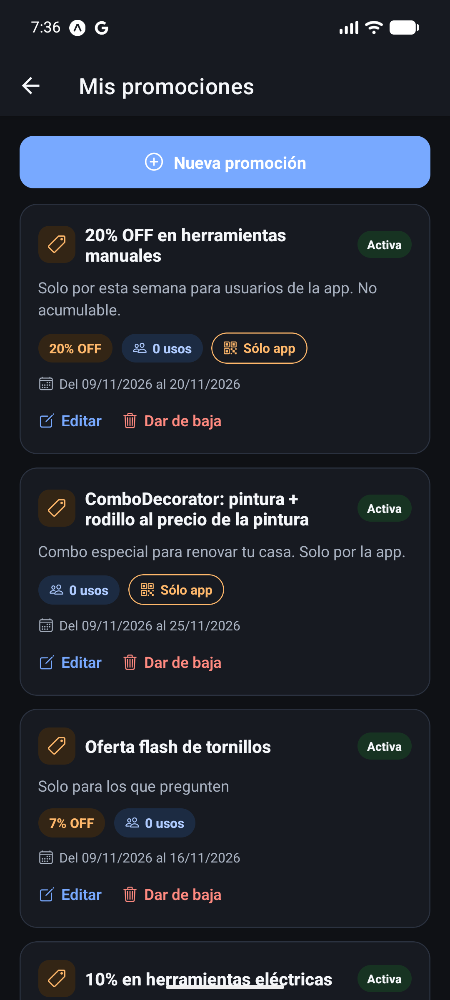

Baja con confirmación:

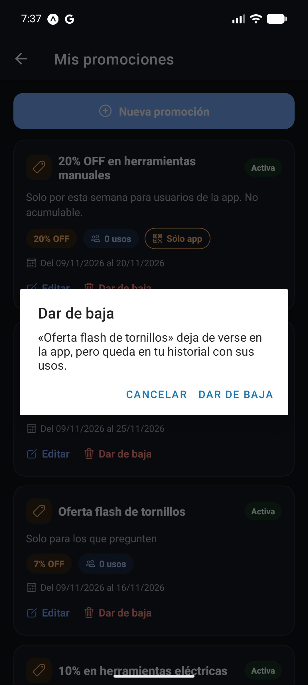

Dada de baja — chip gris, sin acciones, con nota de historial:

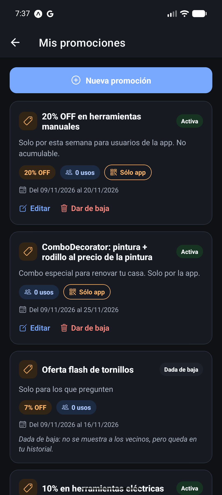

Verificación cruzada: la promo dada de baja **desapareció del listado público**:

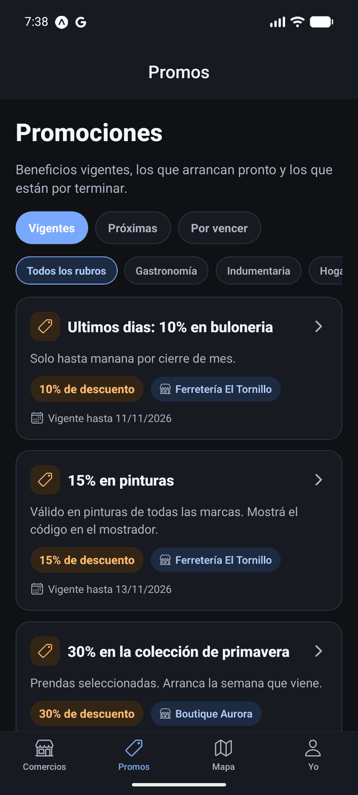

---

## 6. Perfil: rubros de interés y avisos

**Qué había:** para el vecino, el perfil era una tarjeta informativa; los campos `rubrosDeInteres` y `avisosActivos` que usa el módulo de avisos no tenían ninguna UI para cambiarse.

**Qué se cambió:**
- `src/servicios/autenticacion.ts` — `actualizarMiPerfil()` contra `PATCH /yo` (acepta `nombre?`, `rubrosDeInteres?` — reemplaza la lista entera — y `avisosActivos?`).
- `app/(tabs)/perfil.tsx` — nueva sección **"Rubros de interés y avisos"** (sólo cuenta vecino): interruptor "Recibir avisos de promociones" (corta todos los avisos al instante: el módulo de avisos lee el flag en cada revisión) y chips multi-selección de rubros. **Actualización optimista**: el control cambia al toque; si la API rechaza, se revierte y se muestra el mensaje del servidor.

Sección nueva, con el estado previo de marta (Gastronomía + Ferretería):

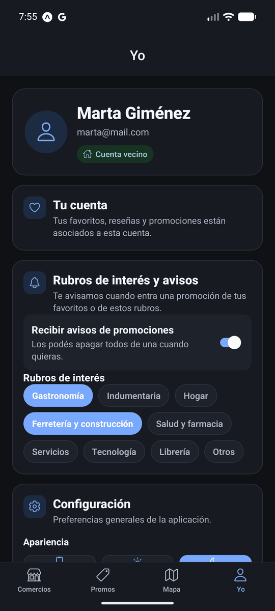

Después de apagar avisos y agregar "Hogar" — verificado leyendo `/yo` directamente: `avisosActivos: false` → reencendido y `rubrosDeInteres` incluyó `rub-hogar`:

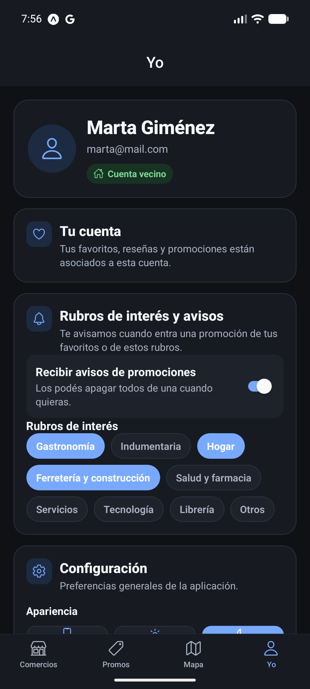

---

## 7. El mapa: filtro por rubro y botón "Ir"

**Qué había:** el mapa mostraba todos los comercios siempre, ordenados por distancia, sin filtro ni forma de abrir el GPS desde ahí. Además, si `obtenerUbicacionActual()` fallaba, el `catch` general tiraba abajo todo el mapa (comercios incluidos).

**Qué se cambió** (`app/(tabs)/mapa.tsx`):
- **Chips de filtro por rubro** (Todos + los 8 rubros): filtran los marcadores del mapa y la lista de cercanos al mismo tiempo. Es el último punto funcional que faltaba del PRD.
- **Botón "Ir"** en cada comercio de la lista: abre Google Maps en modo direcciones (`maps/dir/?api=1&destination=…`) con origen "Your location" y el selector auto / tren / caminando / bici — el "que lo lleve caminando o en auto" del PRD.
- **La ubicación ya no tumba el mapa**: si falla (Play Services frío, permiso negado), queda el aviso y la lista muestra todos los comercios sin distancia — coherente con el "si niega la ubicación, que igual pueda buscar" del PRD.
- **Sin ubicación la lista ya no queda vacía**: antes `comerciosCercanos` devolvía `[]` sin permiso; ahora muestra todos los comercios y sólo omite el chip de distancia.

Mapa con chips, distancias y "Ir":

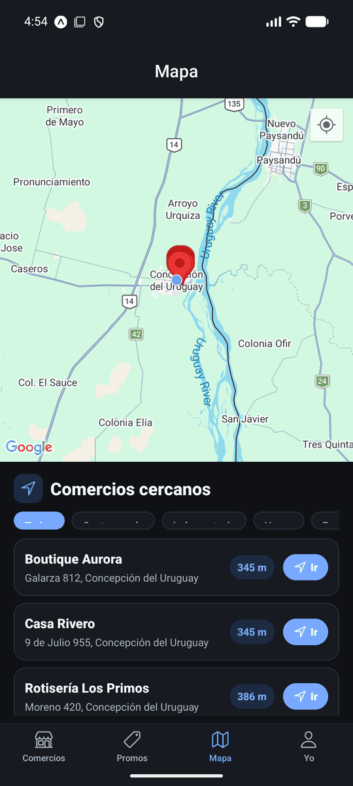

Filtro por Gastronomía aplicado (marcadores y lista):

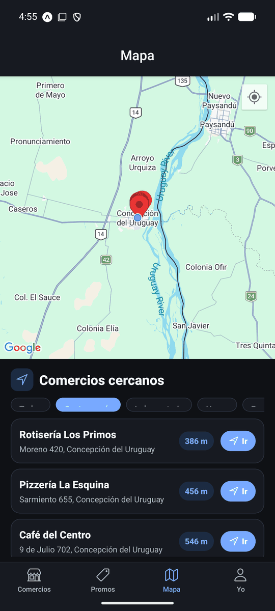

"Ir" abre Google Maps con el selector de modo:

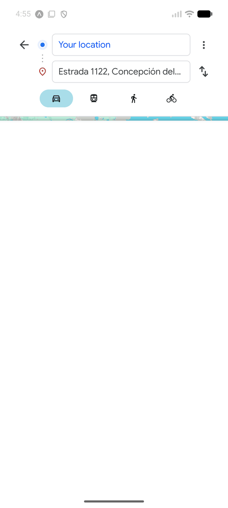

---

## 8. Bugs reales encontrados y corregidos

1. **Los formularios no precargaban al editar** (existía también en la carpeta vieja): los modales viven montados aunque estén cerrados, así que el `useState` inicial no alcanzaba — "Editar mi reseña" abría con 5★ y texto vacío. Corregido con un `useEffect` que sincroniza el estado cada vez que el modal se abre. Aplicado a los tres formularios (reseña, respuesta y promoción).

   Antes del fix (5★ / vacío en lugar de 3★ "Bueno!"):

   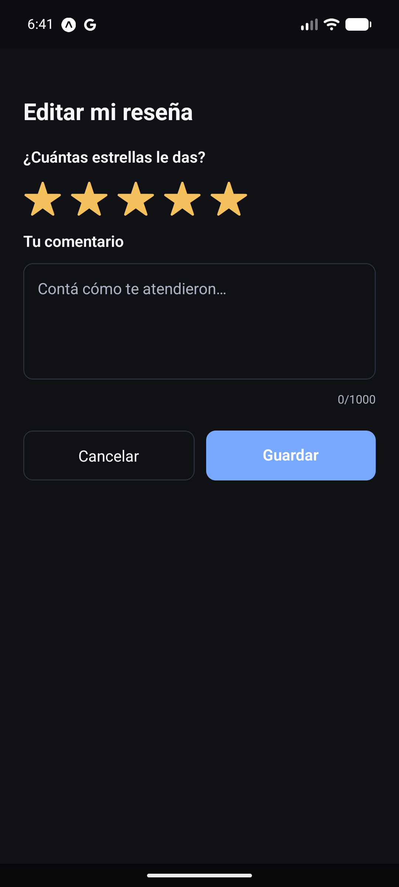

   Después (precarga la reseña existente):

   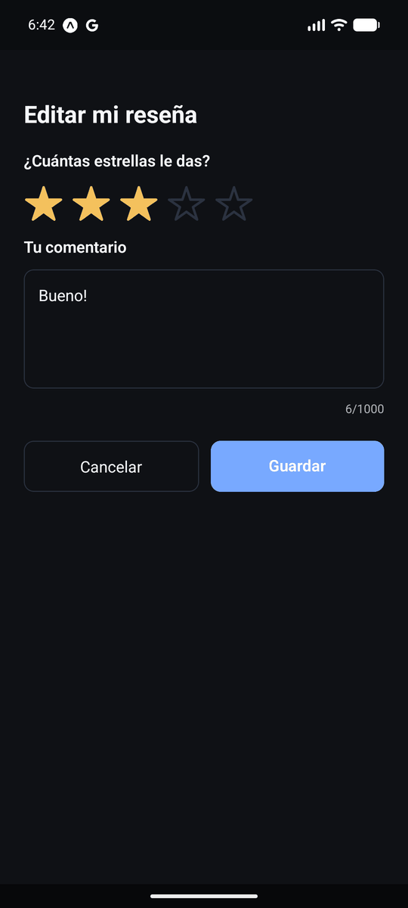

2. **Botón "Responder" visible en reseñas ya respondidas** — detectado por los tests de componente; condición `!resena.respuesta` (ya venía de la carpeta vieja, conservado en el trasplante).

## 9. Avisos de promociones (de la sesión anterior, incluidos en este diff)

Respecto del backup, también entran: `src/servicios/avisos.ts` (revisión de promos nuevas de favoritos/rubros + recordatorios de por vencer, con límites por revisión), `src/hooks/use-avisos-promociones.ts` (revisa al arrancar y al volver a primer plano, máximo una vez cada 5 minutos), helpers en `src/utils/promociones.ts` y el hook montado en `app/_layout.tsx`. Verificado en vivo: promo creada por el comercio → notificación local en la cortina:

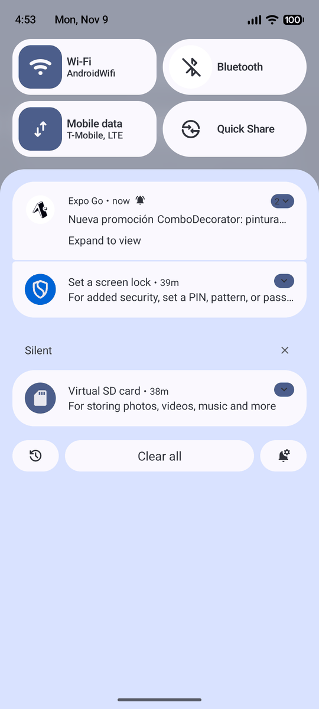

---

## Cómo correr el proyecto

**API de la cátedra** (la app no muestra datos sin ella):
1. Clonar el repo oficial de la cátedra y entrar a `api-directorio-comercios/`.
2. `pnpm install && pnpm dev` — queda en `http://localhost:3000`.
3. Usuarios de demo (contraseña `demo1234` para todos): `marta@mail.com` (vecina), `tornillo@demo.ar` (comercio: Ferretería El Tornillo), `otro.comercio@demo.ar`, `nuevo@demo.ar`.

**App** (requiere Node 20+):
1. `npm install`
2. `npx expo start` — abre Metro en el puerto 8081.
3. En un emulador Android: instalar **Expo Go SDK 54** (la Play Store trae la más nueva, que no sirve; el APK 54.0.8 está en los releases oficiales de `expo/expo-go-releases` en GitHub). Luego `adb reverse tcp:8081 tcp:8081` y abrir en Expo Go `exp://10.0.2.2:8081`.
4. `apiUrl` apunta a `10.0.2.2:3000` (el `localhost` de la máquina anfitriona visto desde el emulador) — está en `app.json` → `extra.apiUrl`.

**Tests:** `npx tsc --noEmit && npx jest` (10 suites, 87 tests).

